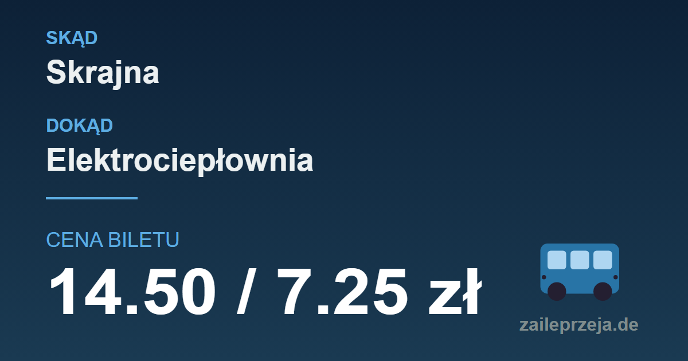
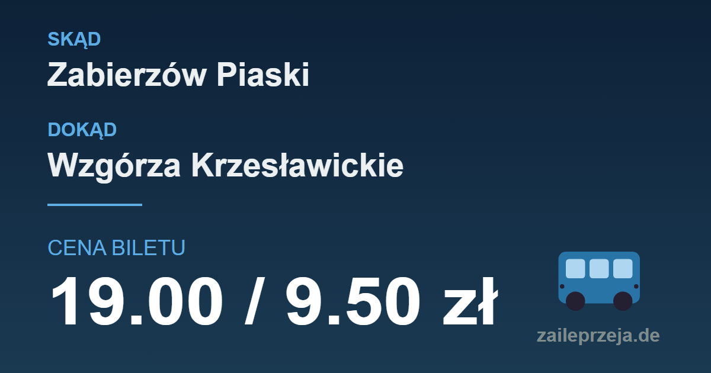

<p align="center">
  
</p>

<h1 align="center">🚌🚊 Za Ile Przejadę?</h1>

<p align="center">
  <a href="https://img.shields.io/endpoint?url=https%3A%2F%2Fzaileprzeja.de%2Fapi%2Fbadge%2Fversion"></a>
  <a href="https://zaileprzeja.de"></a>
  <a href="https://github.com/wertos97/ZaIlePrzejade/commits/main"></a>
</p>

<p align="center">
  <a href="https://zaileprzeja.de"><strong>🌐 zaileprzeja.de</strong></a>
</p>

Kalkulator **planowanej, opcjonalnej taryfy odległościowej** w Krakowie (2027). Taryfa ma działać **obok** obecnych biletów czasowych, jednorazowych i okresowych — pasażer sam wybiera sposób rozliczenia. Start jest **planowany na 4 stycznia 2027 r.**, ale przetarg na system nie jest formalnie zakończony (odwołanie do KIO), więc termin może się przesunąć.

Aplikacja pokazuje połączenia pomiędzy dwoma wybranymi przystankami w **dwóch wariantach**:

- **Trasa tania** — najtańszy wariant w modelu kalkulatora. W pierwszym etapie systemu każdy przejazd pojazdem to osobny bilet liczony od zera — to potwierdzona zasada na pierwsze miesiące. Trasa tania nie zawsze jest najkrótsza.
- **Trasa wygodna** — mniej przesiadek przy rozsądnej cenie.

## Status taryfy i źródła

- **17.12.2025** — Rada Miasta Krakowa przyjęła uchwałę; **2.03.2026** weszły nowe ceny klasyczne, a przepisy taryfy odległościowej mają wejść **4.01.2027** (Zarządzenie nr 425/2026 Prezydenta Miasta Krakowa).
- **23.07.2026** — ZTP ogłosił przetarg na system. Cennik: **4 zł / 2 zł** (ulgowy) do 3,5 km, **+0,50 zł / +0,25 zł** za każde rozpoczęte 500 m, maks. **9 zł / 4,50 zł** za przejazd, limit **20 zł / 10 zł** w 24 h. Taryfa jest opcjonalna; system ma działać m.in. w mKraków; przesiadki mają być uwzględnione w kolejnym etapie.
- **11.09.2026** — ZTP wybrał Mera-Serwis SGL; **21.09.2026** Beesset wniósł odwołanie do KIO (sprawa **4697/26**, rozprawa 14.10.2026). Na 19.10.2026 nie było publicznego rozstrzygnięcia; ostatnie komunikaty nie potwierdzają podpisania umowy. **Start w styczniu 2027 r. nie jest pewny.**
- **Oficjalny dystans jest liczony w linii prostej między początkiem a końcem podróży (A→B)**, a nie wzdłuż trasy (tabela w załączniku do uchwały/Zarządzenia 425/2026). Cena między tymi samymi przystankami ma być stała, niezależnie od objazdu czy korków.
- **Kalkulator liczy dystans tak jak oficjalna taryfa — A→B w linii prostej.** Dla każdego przejazdu bierze odległość między przystankiem wsiadania i wysiadania, więc cena nie zależy od objazdu. Dystans wzdłuż trasy GTFS (`shape_dist_traveled`) pokazujemy osobno jako informację. To nadal model — oficjalny system może zaokrąglać odległość inaczej.
- **Przesiadki:** przez pierwsze około **6 miesięcy** od wdrożenia podstawowej wersji każdy pojazd to osobny, płatny przejazd. Później ma pojawić się łączenie przejazdów; szczegóły (czas, odległość, powrót) nie są opublikowane. Aplikacja pokazuje wyłącznie **aktualny, pierwszy etap** — nie spekuluje, jak będzie wyglądać przyszłe łączenie przesiadek.
- **Kanał:** oficjalna taryfa ma działać **wyłącznie przez aplikacje mobilne** (mKraków lub inne po umowie z ZTP). Pasażer podaje numer pojazdu, rozpoczyna i kończy przejazd; przy kontroli pokazuje kod QR; zapomnienie zakończenia może oznaczać opłatę do końca linii.

Źródła: [ZTP, 23.07.2026](https://ztp.krakow.pl/wszystkie-aktualnosci/kmk/ogloszenie-przetargu-na-wprowadzenie-odleglosciowej-taryfy-biletowej.html), [ZTP, 23.09.2026](https://ztp.krakow.pl/wszystkie-aktualnosci/kmk/taryfa-odleglosciowa-w-kmk-wybrano-wykonawce-wplynelo-odwolanie-do-kio.html), [Miasto Kraków, 2.02.2026](https://krakow.pl/aktualnosci/301273,1912,komunikat,od_2_marca_nowe_ceny_biletow_komunikacji_miejskiej_w_krakowie.html), [Miasto Kraków, 28.09.2026](https://krakow.pl/aktualnosci/338735,1912,komunikat,taryfa_odleglosciowa_w_kmk__po_wyborze_wykonawcy_wplynelo_odwolanie_do_kio.html), [Głos24, 19.10.2026](https://glos24.pl/bilet-za-kilometry-w-krakowie-ztp-wyjasnia-jak-to-ma-dzialac), [TransInfo, 14.09.2026](https://transinfo.pl/infotrans/mera-bierze-kolejny-kontrakt-w-krakowie-i-za-prawie-6-mln-zl-zrobi-taryfe-odleglosciowa/), [Zarządzenie 425/2026](https://www.kk.krakow.pl/aktyprawne/taryfa-biletowa/download,43.html).

## OG Image dla sociali

Aplikacja generuje obrazki OG 1200×630 w formacie PNG dla danej trasy. PNG jest wymagany przez Facebooka, X, Slacka i Discorda; SVG działa tylko jako awaryjny fallback, gdy brakuje Pillow.

| Typowa cena | Dłuższa trasa |
|---|---|
|  |  |

## Wyszukiwanie tras

Podstawą jest graf zbudowany z danych GTFS (`process_gtfs.py` → `processed/`): przystanki z pozycjami, przejazdy linii z **dystansami trasy** (`shape_dist_traveled`) i przejścia piesze między przystankami (peronami). Dystans trasy służy do rysowania trasy i wewnętrznego wyszukiwania; **taryfa liczy linię prostą A→B** między przystankiem wsiadania i wysiadania każdego przejazdu.

1. **Cała jazda liczona naraz** — Dijkstra przechodzi po krawędziach jednej linii i wyznacza koszt jazdy daną linią do wszystkich przystanków jednocześnie.
2. **Składanie tras z przejazdów** — trasa to kilka takich jazd połączonych przesiadkami. Aplikacja składa: jazdy ze startu, jazdy do celu i jazdy pośrednie. Te złożenia pokrywają **wszystkie trasy do 4 przejazdów**, a tańsze opcje odcinają droższe, więc typowa para liczy się w ułamkach sekundy.
3. **Gwarancja najlepszej ceny w modelu kalkulatora** — 5. przejazd zawsze kosztuje co najmniej taryfę bazową, a łączna cena nie może przekroczyć limitu 24-godzinnego. Dlatego najlepsza trasa do 4 przejazdów jest **matematycznie najlepszą możliwą trasą w oficjalnym pierwszym etapie** — i właśnie ją pokazujemy. Gdy żadna trasa nie mieści się w 4 przejazdach, wybieramy trasę z **minimalną liczbą przejazdów** (przy 5+ przejazdach limit 20 zł i tak jest osiągnięty, więc to optimum obu trybów). Nie jest to gwarancja ceny w oficjalnym systemie, który może inaczej zaokrąglać odległości i ma inne zasady przesiadek.
4. **Awaryjne wyszukiwanie** — dla bardzo trudnych par: dokładne przeszukiwanie z limitami czasu (8 s / 8 s / 10 s przy limicie żądania 30 s). Gdy limit przekroczony — błąd dla trybu, nigdy wynik „na oko”.

Dwa tryby różnią się tylko tym, co liczą: **tania** minimalizuje samą taryfę, **wygodna** taryfę powiększoną o 2,00 zł za każde wsiadanie.

## Cache

Wyniki zapisują się w **dwóch miejscach** i żyją, dopóki nie zmienią się dane GTFS (wersja danych i algorytmu jest w nazwie pliku bazy):

- **dysk (sqlite)** — `processed/route_cache_<feed>_<algo>.sqlite`; każda nowa trasa od razu zapisuje się na dysk, więc **przetrwa restart serwera** i czyszczenie pamięci,
- **pamięć RAM** (25 MB) — najczęściej używane trasy; gdy trasy nie ma w pamięci, wraca z dysku w 1–4 ms.

## Model cen (2027)

| Parametr | Wartość |
|----------|---------|
| Bilet bazowy (do 3,5 km) | 4,00 zł / 2,00 zł (ulgowy) |
| Każde kolejne 0,5 km | +0,50 zł / +0,25 zł |
| Maksymalna cena pojedynczego biletu | 9,00 zł / 4,50 zł |
| **Limit 24-godzinny** | **20,00 zł / 10,00 zł** |

Oficjalne przedziały są liczone **w linii prostej A→B** — kalkulator używa tej samej miary, osobno dla każdego przejazdu w pierwszym etapie. Dystans wzdłuż trasy GTFS jest pokazywany tylko informacyjnie. Konfiguracja: [`pricing.json`](pricing.json) (z metadanymi źródła).

## Prywatność

Bez kont, bez reklam, bez Google Analytics i bez profili użytkowników. Strona jest dostarczana przez **Cloudflare** (CDN/ochrona; tunel do serwera) — Cloudflare widzi techniczne dane połączenia i przetwarza je zgodnie z własną polityką. Kafelki mapy serwujemy sami (proxy), więc CARTO nie widzi odwiedzających. Statystyki używają solonego skrótu IP (bez surowego IP), surowe zdarzenia są usuwane po 90 dniach, a dzienne rollupy nie mają identyfikatorów. Pełne szczegóły w aplikacji pod przyciskiem „🔒 Prywatność" (`public/privacy.md`).

Aplikacja ma też panel operatora ze statystykami. Własny ruch operatora jest oznaczany (`op=1`) i domyślnie ukrywany; opcjonalne ciasteczko `operator=1` ustawia tylko operator na własnym urządzeniu.

## Uruchomienie

Wymagania: **Python 3.10+** (testowane na 3.12). Podglądy PNG wymagają **Pillow >= 10.1**; bez Pillow działa awaryjny fallback SVG.

```bash
git clone https://github.com/wertos97/ZaIlePrzejade.git
cd ZaIlePrzejade
python3 -m pip install -r requirements.txt   # Pillow (opcjonalnie, dla PNG)
python3 server.py                # http://localhost:8080
```

Pierwsze uruchomienie pobiera rozkłady GTFS z ZTP i je przetwarza (kilka minut); dane trzymane są lokalnie w `processed/` i nie trafiają do repo.

Dane GTFS przetwarza `process_gtfs.py` (surowe pliki zip w `data/` → `processed/*.json`).

## API

| Endpoint | Opis |
|----------|------|
| `GET /api/find-route?from=<id>&to=<id>` | `{convenient, cheap}` — obie trasy |
| `GET /api/stops` · `/api/stops/search?q=` · `/api/stop?id=` · `/api/stop-platforms?name=` | Przystanki, wyszukiwanie, perony |
| `GET /api/pricing` · `/api/data-info` · `/api/cost?distance=<km>` | Cennik, wersja GTFS, koszt dla dystansu |
| `GET /api/og-image?from=<id>&to=<id>&mode=` | Karta OG (PNG, fallback SVG) |
| `GET /api/health` · `/api/status` · `/api/version` · `/api/maintenance` · `/api/badge/version` | Kondycja serwera, wersja, tryb serwisowy, badge |
| `GET /api/tiles/v2/{z}/{x}/{y}.png` | Proxy kafelków mapy (cache po stronie serwera) |

## Testy

```bash
python3 -m unittest discover -s tests     # 146 testów
```

W tym `TestExactSearchExactness` — na małym grafie testowym algorytm jest porównywany z metodą, która sprawdza wszystkie możliwe trasy. Wyniki muszą się zgadzać. Testy admina wymagają `init_pathfinding`; część testów pomija się, gdy brak danych GTFS.
